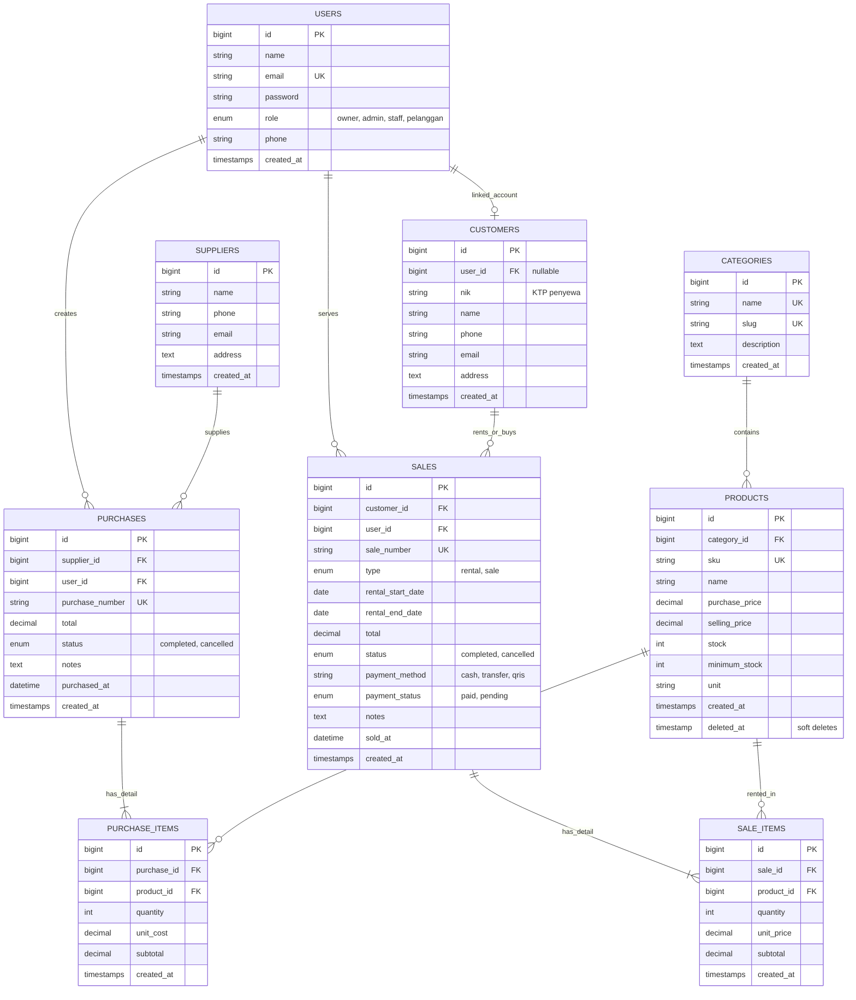

# LensRent - Camera Rental & Inventory Management System
> **Web Programming 2 &bull; Ujian Tengah Semester (UTS) Integrated Laravel Project**  
> Sistem Manajemen Inventaris, Pengadaan Stok (*Stock-In*), dan Transaksi Rental / Penjualan Kamera (*Stock-Out*) Terintegrasi.

---

## 1. Project Overview & Tema Bisnis

**LensRent** adalah aplikasi web manajemen bisnis terintegrasi yang dirancang untuk operasional studio rental kamera dan distributor perlengkapan video/fotografi (kamera mirrorless, kamera cinema, lensa, stabilizer/gimbal, lighting studio, audio microphone, dan aksesoris). 

Sistem ini menyelesaikan tantangan bisnis utama:
1. **Konsistensi Stok**: Stok fisik otomatis bertambah saat pembelian (*Purchase / Stock-In*) dikonfirmasi, dan otomatis berkurang saat rental/penjualan (*Sales / Stock-Out*) berhasil.
2. **Pencegahan Overselling**: Menggunakan mekanisme penguncian baris basis data (`lockForUpdate()`) di dalam transaksi atomik (`DB::transaction`) untuk memastikan tidak ada penyewaan atau penjualan yang melebihi ketersediaan stok fisik.
3. **Integritas Harga Server-Side**: Nilai transaksi dan subtotal dihitung murni di server berdasarkan data produk di database, bukan dipercaya dari masukan browser pengguna.
4. **Role-Based Access Control (RBAC)**: Pemisahan hak akses antara **Owner & Admin** (wewenang penuh yang setara), **Staff** (operasional transaksi dan master data), serta **Pelanggan** (portal khusus penyewa untuk melihat riwayat sewa dan katalog gear).
5. **Entitas Pelanggan (Customer Rental)**: Dilengkapi verifikasi identitas (NIK/KTP), nomor WhatsApp/HP aktif, dan riwayat gear yang sedang disewa.

---

## 2. Entity Relationship Diagram (ERD) & Struktur Database

### Visual Mermaid ERD



### Penjelasan Relasi Eloquent:
- **`Category hasMany Product`** & **`Product belongsTo Category`**: Satu kategori mengelompokkan banyak unit kamera atau perlengkapan.
- **`Supplier hasMany Purchase`** & **`Purchase belongsTo Supplier`**: Pemasok menyediakan stok melalui dokumen *Purchase Order* (PO).
- **`Purchase hasMany PurchaseItem`** & **`PurchaseItem belongsTo Purchase`**: Satu transaksi pembelian terdiri atas banyak rincian item barang.
- **`Customer hasMany Sale`** & **`Sale belongsTo Customer`**: Pelanggan tercatat dalam setiap transaksi sewa/penjualan gear.
- **`Sale hasMany SaleItem`** & **`SaleItem belongsTo Sale`**: Satu invoice transaksi memuat beberapa kamera/lensa yang disewa sekaligus.
- **`Product hasMany SaleItem`** & **`Product hasMany PurchaseItem`**: Hubungan many-to-many antara Produk dan Transaksi melalui tabel perantara (*pivot detail*).

---

## 3. Matriks Hak Akses & Peran Pengguna (RBAC)

Sesuai instruksi khusus: **Owner dan Admin memiliki wewenang setara (*Full Privilege*)**:

| Fitur / Modul | Owner | Admin | Staff | Pelanggan |
|---|:---:|:---:|:---:|:---:|
| **Dashboard Metrik & Statistik** | Full (Finansial & Stok) | Full (Finansial & Stok) | Operasional Stok | Khusus Pelanggan |
| **Katalog & Detail Produk** | Lihat, Tambah, Ubah, Hapus | Lihat, Tambah, Ubah, Hapus | Lihat, Tambah, Ubah | Hanya Melihat Katalog |
| **Kategori & Supplier** | Full CRUD | Full CRUD | Lihat, Tambah, Ubah | Tidak Ada Akses |
| **Pelanggan (Customers)** | Full CRUD | Full CRUD | Lihat, Tambah, Ubah | Profil Sendiri |
| **Transaksi Pembelian (Stock-In)** | Input & Batalkan | Input & Batalkan | Input Transaksi | Tidak Ada Akses |
| **Transaksi Rental/Sales (Stock-Out)** | Input & Batalkan | Input & Batalkan | Input Transaksi | Riwayat Sewa Sendiri |
| **Laporan Finansial & Aset** | Akses Penuh & Cetak | Akses Penuh & Cetak | Tidak Ada Akses | Tidak Ada Akses |
| **Manajemen User & Role** | Akses Penuh | Akses Penuh | Tidak Ada Akses | Tidak Ada Akses |

> **Prinsip Keamanan**: Pembatasan wewenang diamankan di sisi server menggunakan *Middleware* `role:owner,admin` serta Laravel *Gates/Policies*, bukan hanya menyembunyikan tombol di antarmuka Blade.

---

## 4. Akun Demo untuk Pengujian

Semua akun dummy telah disiapkan melalui Database Seeder dengan kata sandi: `password`.

| Role | Nama Pengguna | Alamat Email | Password | Wewenang |
|---|---|---|---|---|
| **Owner** | Budi Hartono | `owner@lensrent.com` | `password` | Wewenang Penuh (Master, Transaksi, Laporan, User) |
| **Admin** | Siti Rahma | `admin@lensrent.com` | `password` | Wewenang Penuh (Setara dengan Owner) |
| **Staff** | Rian Pratama | `staff@lensrent.com` | `password` | Operasional Toko (Input Transaksi & Master) |
| **Pelanggan** | Dimas Anggara | `pelanggan@lensrent.com` | `password` | Portal Customer (Katalog & Status Sewa Aktif) |

> **Tips Kemudahan Demo**: Halaman login menyediakan tombol *1-Click Demo Fill* untuk login secara instan tanpa perlu mengetik manual.

---

## 5. Kebutuhan Sistem & Dependensi

- **PHP**: Versi `>= 8.1.0` (dilengkapi ekstensi `pdo_mysql`, `pdo_sqlite`, `mbstring`, `openssl`, `tokenizer`, `xml`, `ctype`)
- **Basis Data**: MySQL / MariaDB (XAMPP didukung penuh)
- **Composer**: Versi `>= 2.0`
- **Frontend Assets**: Terintegrasi via CDN (Bootstrap 5.3 & Bootstrap Icons), sehingga aplikasi **tidak memerlukan** proses kompilasi `npm install` / `npm run build` yang rumit.

---

## 6. Panduan Instalasi Langkah-demi-Langkah

### Langkah 1: Kloning / Buka Direktori Proyek
```bash
cd "c:\Users\USER\Downloads\inventory sales"
```

### Langkah 2: Instal Dependensi PHP
```bash
composer install
```

### Langkah 3: Konfigurasi Lingkungan (`.env`)
Salin file `.env.example` menjadi `.env`:
```bash
copy .env.example .env
php artisan key:generate
```

Pastikan konfigurasi database di file `.env` mengarah ke MySQL lokal Anda:
```env
DB_CONNECTION=mysql
DB_HOST=127.0.0.1
DB_PORT=3306
DB_DATABASE=inventory_sales
DB_USERNAME=root
DB_PASSWORD=
```
*(Pastikan database `inventory_sales` sudah dibuat di MySQL/phpMyAdmin)*

### Langkah 4: Jalankan Migration & Seeder
Buat seluruh struktur tabel dan isi dengan data demo kamera realistis:
```bash
php artisan migrate:fresh --seed
```

### Langkah 5: Jalankan Server Lokal Laravel
```bash
php artisan serve
```
Akses aplikasi melalui browser di: **`http://127.0.0.1:8000`**

---

## 7. Menjalankan Automated Test Suite (Pengujian Otomatis)

Proyek ini telah dilengkapi dengan 17 skenario pengujian otomatis (*Unit & Feature Tests*) mencakup seluruh *Test Scenario Minimum* dari rubrik penilaian UTS:

```bash
php artisan test
```

### Cakupan Pengujian:
1. `AuthTest`:
   - Guest tidak dapat membuka dashboard (dialihkan ke `/login`).
   - Kata sandi keliru ditolak dengan pesan validasi.
   - Login dengan kredensial benar berhasil masuk ke sesi autentikasi.
2. `ProductTest`:
   - SKU produk duplikat ditolak oleh validasi basis data dan controller.
   - Harga beli, tarif sewa, atau stok bernilai negatif ditolak.
   - Produk kamera valid berhasil disimpan.
3. `PurchaseTransactionTest`:
   - Transaksi pengadaan stok (*stock-in*) berhasil menambah stok produk fisik secara akurat.
4. `SaleTransactionTest`:
   - Transaksi rental/penjualan berhasil mengurangi stok produk.
   - Perhitungan total transaksi dihitung murni di server (tidak mempercayai input klien).
   - Penjualan dengan stok tidak cukup ditolak (*insufficient stock*) tanpa mengubah data.
   - Atomisitas transaksi: Jika salah satu item gagal dalam transaksi multi-item, seluruh transaksi di-*rollback* (`DB::transaction`).
   - Pembatalan transaksi (*cancellation*) oleh Admin/Owner memulihkan kembali stok unit ke inventaris.
5. `AuthorizationTest`:
   - Staff ditolak dengan status HTTP 403 (*Forbidden*) saat mencoba membuka halaman Manajemen Pengguna (`/users`).
   - Staff ditolak saat mencoba menghapus produk kamera sensitif.
   - Admin dan Owner sama-sama memiliki izin membuka Manajemen Pengguna.
   - Staff diizinkan melihat katalog dan mencatat transaksi.

---

## 8. Panduan Wawancara Kepemilikan Kode (*Code Ownership Interview*)

Berikut adalah referensi jawaban teknis untuk pertanyaan yang sering diajukan dosen penguji:

### Q1: Mengapa model `Sale` memiliki relasi `hasMany()` ke `SaleItem`, bukan langsung ke `Product`?
> **Jawaban**: Satu transaksi rental atau penjualan dapat memuat lebih dari satu jenis kamera atau gear (misalnya menyewa 1 kamera Sony A7 IV, 1 lensa 24-70mm, dan 2 baterai cadangan sekaligus). Hubungan antara Transaksi dan Produk adalah *Many-to-Many*. Tabel `sale_items` bertindak sebagai tabel perantara (*pivot table*) yang juga menyimpan data historis transaksi saat itu, seperti kuantitas (`quantity`), tarif saat transaksi terjadi (`unit_price`), dan subtotal per item.

### Q2: Di mana sistem memastikan stok tidak bernilai negatif?
> **Jawaban**: Pemeriksaan stok dilakukan secara berlapis:
> 1. Pada antarmuka Blade (`sales/create.blade.php`), input kuantitas dibatasi oleh atribut `max` dan script interaktif yang memperingatkan kasir jika kuantitas melebihi stok yang tersedia.
> 2. Yang paling utama di sisi server pada `SaleController::store()`, baris produk dikunci dengan `Product::lockForUpdate()` lalu dicek kondisi:
>    ```php
>    if ($qty < 1 || $product->stock < $qty) {
>        throw ValidationException::withMessages([
>            'items' => "Stok produk {$product->name} tidak mencukupi (Tersedia: {$product->stock}, Diminta: {$qty})."
>        ]);
>    }
>    ```
>    Jika kuantitas melebihi stok, eksepsi dilemparkan dan transaksi dibatalkan seketika.

### Q3: Mengapa total transaksi penjualan/rental dihitung di server, bukan dari browser?
> **Jawaban**: Masukan dari browser (klien) sangat rentan dimanipulasi melalui *Inspect Element* atau alat seperti Postman. Untuk menjamin integritas finansial, server mengambil harga produk resmi langsung dari database (`$product->selling_price`), mengalikannya dengan kuantitas dan durasi hari sewa, lalu menjumlahkannya menjadi grand total. Input harga dari browser sama sekali diabaikan.

### Q4: Apa risiko jika pengurangan stok dilakukan di luar `DB::transaction`?
> **Jawaban**: Tanpa `DB::transaction`, jika terjadi kesalahan (misalnya koneksi database terputus saat menyimpan item ke-2, atau terjadi kegagalan sistem setelah header transaksi dibuat), perubahan yang sudah terjadi tidak akan dibatalkan (*tidak ada rollback*). Akibatnya data menjadi tidak konsisten: header transaksi tersimpan tetapi itemnya kosong, atau stok sudah terlanjur berkurang padahal transaksi gagal.

### Q5: Apa peran `Product::lockForUpdate()` pada transaksi bersamaan (*concurrency*)?
> **Jawaban**: `lockForUpdate()` menerapkan *pessimistic locking* pada tingkat baris database MySQL. Ketika dua kasir/staff memproses sewa untuk sisa 1 unit kamera yang sama pada detik yang bersamaan, request kedua akan menunggu sampai request pertama selesai. Hal ini mencegah kondisi balapan (*race condition*) dan menjamin tidak pernah terjadi *overselling* (stok minus).

### Q6: Bagaimana mencegah Staff mengakses halaman Admin melalui pengetikan URL langsung?
> **Jawaban**: Melalui *Route Middleware* `role:admin,owner` yang didaftarkan pada `app/Http/Middleware/RoleMiddleware.php`. Ketika Staff mengetik URL seperti `/users` atau `/reports`, middleware memeriksa `auth()->user()->role`. Jika role tidak terdaftar dalam izin rute, aplikasi langsung mengeksekusi `abort(403, 'Akses Ditolak')`, sehingga proteksi tidak bergantung pada tampilan menu semata.

---

## 9. Struktur Direktori Utama

```
inventory-sales/
├── app/
│   ├── Http/
│   │   ├── Controllers/
│   │   │   ├── AuthController.php          # Autentikasi Login, Logout & Demo Fill
│   │   │   ├── CategoryController.php      # CRUD Kategori Gear
│   │   │   ├── CustomerController.php      # CRUD Pelanggan Rental Kamera
│   │   │   ├── DashboardController.php     # Metrik Real-time & Portal Pelanggan
│   │   │   ├── ProductController.php       # Inventaris Kamera, Filter & Soft Delete
│   │   │   ├── PurchaseController.php      # Stock-In & Restock Pengadaan
│   │   │   ├── ReportController.php        # Laporan Finansial & Valuasi Aset
│   │   │   ├── SaleController.php          # Rental & Penjualan (Stock-Out)
│   │   │   ├── SupplierController.php      # CRUD Distributor & Vendor
│   │   │   └── UserController.php          # Manajemen Pengguna & Hak Akses
│   │   └── Middleware/
│   │       └── RoleMiddleware.php          # Proteksi Otorisasi Server-Side (RBAC)
│   ├── Models/                             # Eloquent Models & Relasi Lengkap
│   └── Providers/
│       └── AuthServiceProvider.php         # Definisi Gate Otorisasi
├── database/
│   ├── migrations/                         # Skema 8 Tabel Relasional + Indexes
│   └── seeders/
│       └── DatabaseSeeder.php              # Seeder Akun Demo, Kategori & Produk
├── resources/
│   └── views/                              # Tampilan Blade Reusable & Responsif
│       ├── auth/
│       ├── categories/
│       ├── customers/
│       ├── dashboard/
│       ├── layouts/
│       ├── products/
│       ├── purchases/
│       ├── reports/
│       ├── sales/
│       └── users/
├── routes/
│   └── web.php                             # Rute Terproteksi Auth & Role
└── tests/
    └── Feature/                            # 17 Pengujian Otomatis Fitur Inti
```

---

## 10. Lisensi & Pernyataan Orisinalitas

Proyek ini dibangun secara mandiri untuk memenuhi kriteria penilaian **Ujian Tengah Semester (UTS) Web Programming 2**, menerapkan kaidah standar pengembangan Laravel modern (*Clean Code*, *Database Transaction*, *Eloquent Relationship*, *Server-side Validation*, dan *Role-based Authorization*).
